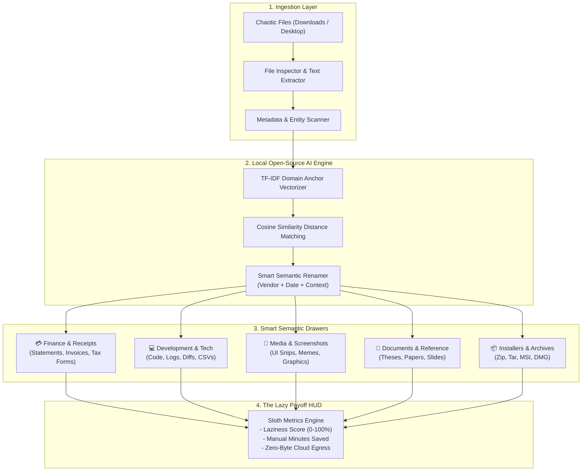

# 🦥 SlothDesk

> **The Open-Source Local AI Janitor for Chaotic Desktops and Downloads.**  
> Channel your inner sloth. Open-source local inference sorts, renames, and files your digital clutter so you don't have to.

[]()
[](LICENSE)
[](https://www.python.org/)
[](https://fastapi.tiangolo.com/)
[]()

---

## Overview

Every developer and knowledge worker's `Desktop` and `Downloads` folders devolve into a chaotic digital landfill:
- `Screenshot 2026-10-24 at 11.23.41 PM.png`
- `statement (2).pdf`
- `Uber_trip_receipt_e83912.pdf`
- `customers_dump_2026_raw.csv`
- `docker-compose.staging.yml`
- `node-v22.1.0-x64.msi`

Manually organizing hundreds of files is the ultimate procrastination chore. 

**SlothDesk** automates this entirely on your machine. Using open-source natural language processing and semantic vector classification (scikit-learn TF-IDF semantic vector anchors + heuristic entity and date extractors), SlothDesk automatically:
1. **Understands file content**: Identifies financial records, developer artifacts, screen captures, academic documents, and archive bundles.
2. **Generates clean, descriptive names**: Replaces meaningless timestamps with vendor names, document types, and normalized ISO dates (e.g. `chase_bank_statement_2026-10.pdf`, `uber_receipt_2026-10-24.pdf`, `aws_screenshot_2026-10-24.png`).
3. **Files items into smart drawers**: Moves files into organized directories with zero effort.
4. **Guarantees 100% privacy**: No sensitive tax forms (W-2/1099), paystubs, or proprietary code paths ever leave localhost. Zero cloud tokens, zero API fees.

---

## Architecture



---

## Key Features

- **⚡ One-Click Sloth Tidying**: Run a simulated interactive tidy in the web UI, or run the local CLI on your real files.
- **🏷️ Semantic Renaming Pipeline**: Automatically parses dates (`YYYY-MM-DD`, `Month YYYY`), recognized entities (`Chase`, `Uber`, `AWS`, `Stripe`, `GitHub`), and file types (`Statement`, `Diff`, `Receipt`, `Thesis`).
- **🛡️ 100% Air-Gapped Privacy**: Your bank accounts, salary numbers, and private git diffs remain strictly on your device.
- **🦥 Sloth Debounce Watcher**: Background daemon monitors directories with patience—waiting until large browser downloads finish before moving files.
- **📊 The Lazy Payoff HUD**: Quantifies your procrastination gains with real-time stats (minutes saved, files sorted, hoarder rating).
- **🚀 Ultra-Lightweight & Render Ready**: Operates comfortably in under $200\text{MB}$ of RAM, making it deployable on free cloud tiers and instant to run on any laptop.

---

## Tech Stack

- **Backend**: Python 3.10+, [FastAPI](https://fastapi.tiangolo.com/), [Uvicorn](https://www.uvicorn.org/)
- **Machine Learning**: [scikit-learn](https://scikit-learn.org/) (TF-IDF Vectorizer & Cosine Metric Anchors), NumPy
- **System & File Inspection**: [Watchdog](https://github.com/gorakhargosh/watchdog) (Debounced FS Events), PyPDF, Python Multipart
- **Frontend**: Editorial Dark-Canopy UI, Vanilla JavaScript, Jinja2 Templates, Lucide Icons

---

## Quickstart

### 1. Installation

```bash
git clone https://github.com/titas-mahato/slothdesk.git
cd slothdesk
pip install -r requirements.txt
```

### 2. Run Web Dashboard

```bash
python main.py
```

Visit `http://localhost:8000` in your browser.
- Click **"Generate Cluttered Desktop"** to populate realistic messy files.
- Click **"Channel Inner Sloth (One-Click Clean)"** to watch the local AI sort and rename them in real-time.
- Drop your own files into the upload dropzone to inspect their local classification.

### 3. Run Background Daemon

Watch your actual `Downloads` folder with sloth-style debounce:

```bash
# Preview mode (safe dry run)
python -m app.daemon --path ~/Downloads --dry-run

# Active mode
python -m app.daemon --path ~/Downloads --debounce 8
```

---

## Verification & Testing

SlothDesk includes a unit and integration test suite:

```bash
# Run classifier tests
python tests/test_classifier.py

# Run API endpoint tests
python tests/test_api.py

# Run end-to-end core verification
python tests/test_core.py
```

---

## Why Open Innovation Matters

| Dimension | Proprietary Closed AI (Cloud LLMs) | SlothDesk (Open-Source Local AI) |
| :--- | :--- | :--- |
| **Data Privacy** | Sensitive bank statements and tax PDFs sent to third-party servers | **100% local on localhost; zero data egress** |
| **Operating Cost** | Recurring token billing for constant background folder polling | **\$0.00 / month forever** |
| **Offline Reliability** | Fails completely on flights or without internet connection | **Runs autonomously with zero internet** |
| **Speed & Resource** | 2–5 second cloud API roundtrips; high network latency | **< 20ms per file classification; lightweight footprint** |

---

## License

MIT License. Built with open-source AI and local inference.
